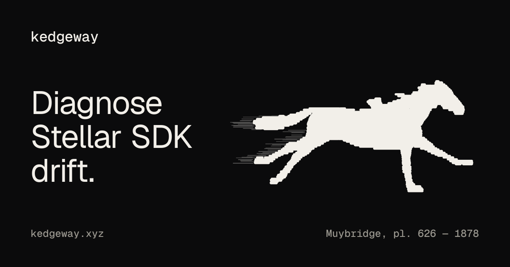
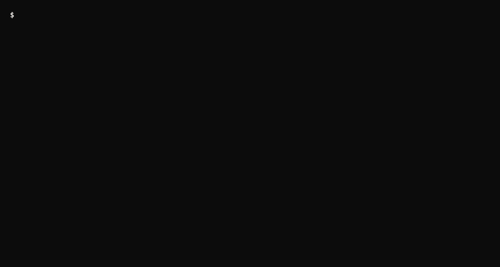

<div align="center">



<h3>Diagnose Stellar SDK drift against the live ecosystem.</h3>

[](https://github.com/Klorenn/kedgeway/actions/workflows/ci.yml)
[](https://www.npmjs.com/package/kedgeway)
[](LICENSE)
[](package.json)

[Website](https://kedgeway.vercel.app) · [Docs](https://kedgeway.vercel.app/docs) · [Changelog](CHANGELOG.md)



</div>

## Why

Soroban moves fast, and repos fall behind quietly. On 2026-11-11, Scout (via Stellar Raven) counted **5,863** Stellar repositories and found **1,285 of them (22%)** on a deprecated `soroban-sdk`.

kedgeway tells you where your repo stands before that becomes a surprise, and lets you gate CI on it.

## How it works

- **Scan.** Reads every `Cargo.toml` and `package.json` in your repo, locally.
- **Ask Raven.** Fetches the current SDK versions and the deprecated set from the [Stellar Raven](https://raven.stellar.org/mcp) MCP server.
- **Diagnose.** Compares the two and reports findings with severity and evidence.

What leaves your machine: only the script kedgeway sends to Raven's `execute` tool. Your repo contents never do.

## Install

Requires Node >= 22.12. Not on npm yet (coming soon), so build from source:

```sh
git clone https://github.com/Klorenn/kedgeway
cd kedgeway
npm ci
npm run build   # emits dist/cli.js
npm link        # optional: exposes `kedgeway`
```

## Usage

```sh
kedgeway login                                # force the OAuth flow
kedgeway logout                               # delete stored credentials
kedgeway diagnose [path]                      # human-readable report
kedgeway diagnose . --json                    # Diagnosis as JSON
kedgeway diagnose . --fail-on warning         # exit 2 on any finding >= warning
kedgeway diagnose . --fixture snapshot.json   # offline, no Raven
```

Raven is OAuth-protected. Each run tries stored credentials silently; only on a 401 does it open the browser (authorization code + PKCE). Credentials live in `~/.config/kedgeway/auth.json` (mode 0600).

### Flags

| Flag | Meaning |
| ---- | ------- |
| `--json` | Print the Diagnosis as JSON |
| `--fixture <file>` | Use an ecosystem snapshot JSON instead of Raven (offline) |
| `--fail-on <severity>` | Exit 2 if any finding is at or above `critical`, `warning` or `info` |

### Exit codes

| Code | Meaning |
| ---- | ------- |
| `0` | OK |
| `1` | Tool error |
| `2` | A finding met `--fail-on` |

## Findings

kedgeway detects `soroban-sdk` in every `Cargo.toml` (string and table forms, renamed deps, `[workspace.dependencies]`, `workspace = true`) and `@stellar/stellar-sdk`, `stellar-sdk`, `@stellar/stellar-base` and `soroban-client` in every `package.json`.

| Code | Severity | Meaning |
| ---- | -------- | ------- |
| `SDK_DEPRECATED` | critical | `soroban-sdk` major is in the Scout deprecated sample and below current, or 2+ majors behind |
| `SDK_BEHIND` | warning | `soroban-sdk` is exactly one major behind |
| `SDK_CURRENT` | info | `soroban-sdk` is on the current major |
| `SDK_UNKNOWN` | warning | `soroban-sdk` version could not be resolved |
| `JS_SDK_DEPRECATED` | critical | `@stellar/stellar-sdk` / `@stellar/stellar-base` two or more majors behind |
| `JS_SDK_BEHIND` | warning | JS SDK is exactly one major behind |
| `JS_SDK_CURRENT` | info | JS SDK is on the current major |
| `JS_SDK_UNKNOWN` | warning | JS SDK version could not be resolved |
| `JS_LEGACY_PACKAGE` | critical | Legacy package such as `soroban-client` or `stellar-sdk` |
| `NO_SDK_FOUND` | info | No Stellar SDK dependency found |
| `MANIFEST_UNPARSEABLE` | warning | A manifest or directory could not be read or parsed, so it was not checked |
| `DATA_DEGRADED` | warning | Part of the ecosystem data could not be fetched or parsed |

Version ranges that do not pin a major (`<21`, `a || b`) are reported as `*_UNKNOWN`.

## CI

```yaml
name: kedgeway
on: [push, pull_request]
jobs:
  diagnose:
    runs-on: ubuntu-latest
    steps:
      - uses: actions/checkout@v4
      - uses: actions/setup-node@v4
        with:
          node-version: 22
      - run: |
          git clone https://github.com/Klorenn/kedgeway /tmp/kedgeway
          (cd /tmp/kedgeway && npm ci && npm run build && npm link)
      - run: kedgeway diagnose . --fail-on warning --fixture snapshot.json
```

OAuth in CI is not supported yet, so `--fixture` is the offline path: commit an ecosystem snapshot and refresh it from a machine where you are logged in.

## Data sources

- **Official docs** (`/docs/networks/software-versions`): the "current" versions, parsed inside Raven's sandbox.
- **Scout**: a sample of deprecated `soroban-sdk` versions, used only for majors below the official current.
- **Stellar Raven**: the MCP gateway that serves both.

## Limitations

- If the software-versions page changes shape, kedgeway reports `DATA_DEGRADED` / `SDK_UNKNOWN` instead of guessing.
- Scout's deprecated set is a capped sample and can disagree with the docs; matching is by major.
- `@stellar/stellar-base` is compared against the `@stellar/stellar-sdk` major.
- Scanning stops at depth 4 and skips `node_modules`, `target`, `dist`, `.git`, `.next`, `vendor`, `build`, `coverage`.
- Diagnosis only: no migration.
- The live OAuth flow is not covered by automated tests.

## Roadmap

Not shipped yet:

- [ ] Publish to npm
- [ ] Non-interactive auth for CI
- [ ] Guided migration, not just diagnosis

## The name

A kedge is a small anchor carried out from a drifting ship and hauled in to pull it back on course. kedgeway does that for a Stellar repo's SDK versions.

## Contributing

Read [CONTRIBUTING.md](CONTRIBUTING.md) and the [Code of Conduct](CODE_OF_CONDUCT.md). Report vulnerabilities as described in [SECURITY.md](SECURITY.md).

## License

[MIT](LICENSE)

<div align="center">

Built on [Stellar Raven](https://raven.stellar.org/mcp) · Mark after Muybridge, *The Horse in Motion* (1878)

</div>
